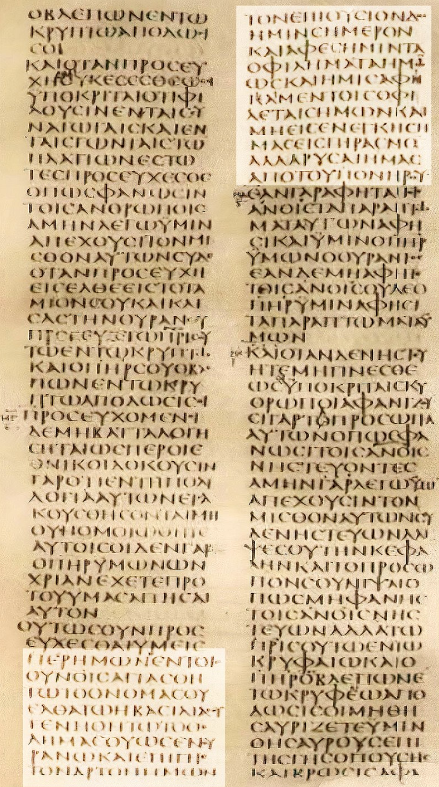

# ΚΥΡΙΑΚΗ ΠΡΟΣΕΥΧΗ (ΠΑΤΕΡ ΗΜΩΝ)

Η εφαρμογή Κυριακή προσευχή περιέχει την κύρια προσευχή των Χριστιανών Ορθοδόξων η οποιά παραδόθηκε από τον ίδιο τον Ιησού Χριστό στους μαθητές του.

Η προσευχή αυτή αναφέρεται στο κατα Ματθαίον Ευαγγέλιο (κεφάλαιο 6:9-13)

Αποτελεί μία προσευχή προς στον Θεό Πατέρα, ζητώντας τον αγιασμό του ονόματός του, την έλευση της βασιλείας του, το θέλημα του να γίνεται όπως στον ουρανό, την καθημερινή τροφή, τη συγχώρεση αμαρτιών και την προστασία από τον πειρασμό και τον πονηρό.

